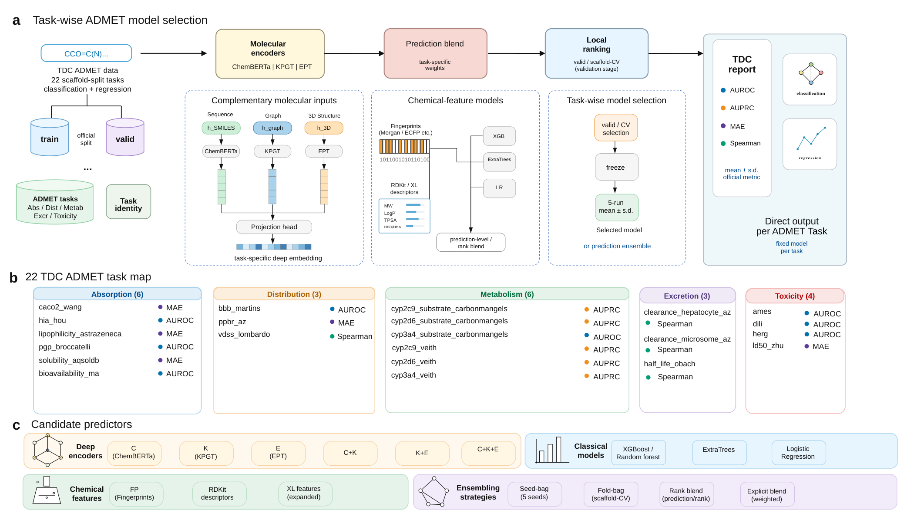

# Trimole-Hybrid

This repository provides source code, task configurations and result records for the manuscript **Task-wise model selection for heterogeneous ADMET prediction**.

## Release status

This release provides source code, final task configurations and published result records. Checkpoint weights are not attached to the release. The 155-entry manifest describes located artifacts, including partial component sets; eight tasks have no saved original estimator. The package is not a complete set of assets for end-to-end reproduction of all 22 reported systems.

Trimole-Hybrid uses SMILES, graph, geometry-sensitive and chemical-feature predictors for 22 TDC ADMET tasks. Each task has a fixed predictor or prediction combination.



## Contents

- [Installation](#installation)
- [Data preparation](#data-preparation)
- [Trained models and configurations](#trained-models-and-configurations)
- [Usage](#usage)
- [Supplementary results](#supplementary-results)
- [Citation](#citation)

## Installation

Clone the repository and create the core environment:

```bash
git clone https://github.com/dchen0212/trimole_hybrid.git
cd trimole_hybrid
conda env create -f environment.yml
conda activate trimole-hybrid
```

The core environment records Python 3.10 and PyTorch 2.5.1 with CUDA 12.1. KPGT feature extraction uses its [separate environment](code/KPGT/environment.yml):

```bash
conda env create -f code/KPGT/environment.yml
```

See [environment and input details](docs/USAGE.md) for the task-specific dependencies and feature layout.

## Data preparation

The benchmark comprises the 22 tasks in the [TDC ADMET benchmark group](https://tdcommons.ai/benchmark/admet_group/). Use the task identifiers and split definitions in the [current Supplementary Table S1](supplementary_tables/Table_S1_dataset_provenance.csv). For fixed-component retraining, use training rows for fitting, validation rows for the documented stopping and setting choices, and official test rows for final scoring. Experiment-specific data roles are described in Supplementary Notes 3A–3B.

- [Complete supplementary data](https://github.com/dchen0212/trimole_hybrid/releases/download/v2026.10.28/Supplementary_Data.zip)
- [Current 20-page supplement](supplementary/supplementary.pdf)
- [Current tables](supplementary_tables/) and [Figures S1–S3](supplementary_figures/)
- [Table and figure source-data index](supplementary_data/)

The data download includes run scores, row identifiers, model settings and analysis protocols. The matched solubility comparison uses the same 1,995 rows for all three molecular models.

For molecular features, the repository contains [ChemBERTa](code/trimole_ept_swap_v1/trimole/embeddings/chemberta.py), [KPGT](code/KPGT/) and [Uni-Mol](code/trimole_ept_swap_v1/trimole/embeddings/unimol.py) interfaces. The feature-head input layout is described in [Usage](docs/USAGE.md).

## Trained models and configurations

- [Final task configurations and source code](https://github.com/dchen0212/trimole_hybrid/releases/download/v2026.10.28/Final_Model_Configuration_and_Code.zip)
- [Checkpoint manifest](https://github.com/dchen0212/trimole_hybrid/releases/download/v2026.10.28/Checkpoint_Manifest.json)
- [Model download and configuration guide](models/)

The configuration package contains one JSON record per task, with model components, training settings, seeds and fixed combination weights. The manifest identifies 155 located fitted artifacts by task, seed, size and SHA256. Weight files are not included in this release.

## Usage

### Inspect a final configuration

Download and extract the configuration package above, then inspect a task:

```bash
unzip Final_Model_Configuration_and_Code.zip -d model_files
python -m json.tool model_files/configs/tasks/pgp_broccatelli.json
```

### Train a recorded feature-head component

The original [feature-head trainer](code/trimole_ept_swap_v1/trimole/training/trainer.py) takes a prepared task directory and a fixed `TrainConfig`. The example below uses the recorded P-gp component and seed, without a configuration search:

```bash
PYTHONPATH=code/trimole_ept_swap_v1 python - <<'PY'
import json
from pathlib import Path
from trimole.training.trainer import TrainConfig, fit_on_task

task = json.loads(Path("model_files/configs/tasks/pgp_broccatelli.json").read_text())
component = next(c for c in task["components_bound"] if c["id"] == "layerwise")
run = next(r for r in component["fitted_runs"] if r["seed"] == 1)
fit_on_task(
    Path("data/pgp_broccatelli"),
    Path("outputs/pgp_broccatelli/layerwise_seed1"),
    TrainConfig(**run["config"]),
)
PY
```

This fits the named component. The task JSON records the other components and final prediction transformation. Classical endpoints and target-only models use the implementations and settings linked in the [model guide](models/) and [training documentation](docs/USAGE.md).

## Results and code

The [result-to-code guide](docs/RESULT_CODE_MAP.md) maps paper sections, tables and figures to implementation entry points and archived analysis scripts.

## Supplementary results

The [supplementary-data index](supplementary_data/) maps manuscript Figure 4 and Supplementary Tables S1–S14 and Figures S1–S3 to their source records. It includes the external-model comparisons, FLAML budget comparisons, ablations and subgroup analyses.

### Release correspondence

| Resource | Role |
|---|---|
| [GitHub v2026.10.28](https://github.com/dchen0212/trimole_hybrid/releases/tag/v2026.10.28) | Current data, configuration package and 20-page supplement aligned to the author-selected v130 submission supplement |
| [Zenodo 2026.10.24](https://doi.org/10.5281/zenodo.23602309) | Immutable earlier code and analysis archive, including source scripts used by the current result-to-code guide |

The current supplementary package includes completed 180-s FLAML records. S4 compares the task-wise configuration with five fixed-pool controls and two FLAML budgets; S4a reports 32 trials, 60 s, 120 s and 180 s in the separate nine-predictor pool. The earlier three-setting records predate the 180-s extension.

## Citation

If you use Trimole-Hybrid, please cite the manuscript:

```bibtex
@unpublished{luo2026trimolehybrid,
  title = {Task-wise model selection for heterogeneous ADMET prediction},
  author = {Luo, Zhensheng and Huang, Dachen and Shao, Yanruisheng and Yu, Qinze and Li, Yu},
  year = {2026},
  note = {Manuscript},
  url = {https://github.com/dchen0212/trimole_hybrid}
}
```

The manuscript has not yet been published. The DOI above identifies the code archive.

## License

Original code is licensed under [Apache-2.0](LICENSE). Third-party code retains its own license; see [NOTICE](NOTICE).
